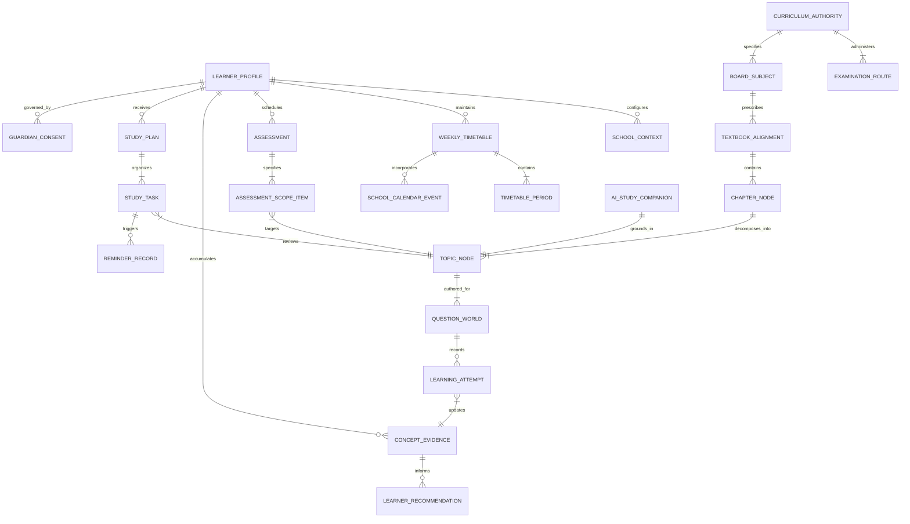
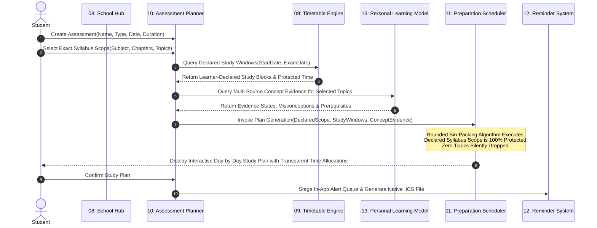
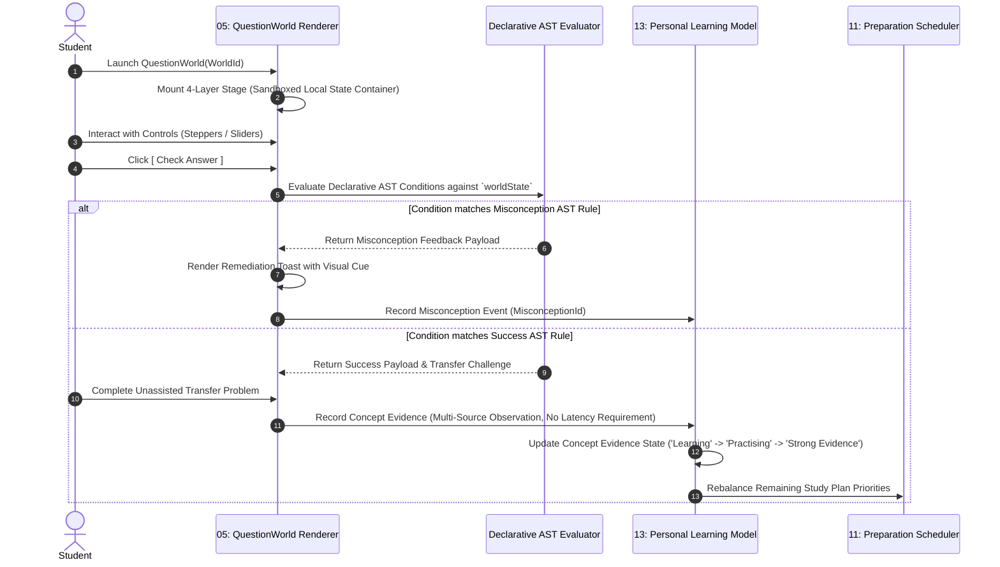

# INTEGRATION AND DATA MODEL ARCHITECTURE MAP
**Document ID:** GPL-SPEC-INT-V1  
**Project:** Gramin PocketLab — K–12 Multi-Board Learning Ecosystem  
**Target Audience:** Lead Architects, Systems Engineers, Full-Stack Developers  
**Status:** Draft — Task v6 Security, Validation & Evidence Reconciliation Completed
**Classification:** Complete System Topography, Entity Relationships & Integration Contracts  

---

## 1. System Topography & The 17 Core Subsystems

Gramin PocketLab is structured as an interconnected constellation of 17 modular subsystems operating under a unified local-first state container:

```
+---------------------------------------------------------------------------------------------------+
|                                GRAMIN POCKETLAB SYSTEM TOPOGRAPHY                                 |
+---------------------------------------------------------------------------------------------------+
|  [01] Curriculum Authority Registry [02] Textbook & Resource Catalogue  [03] Lesson & Content Engine|
|  [04] Question Bank                 [05] QuestionWorld AST Renderer      [06] Age-Adaptive Design Sys|
|  [07] Learner Profiles              [08] School Hub                      [09] Timetable Engine       |
|  [10] Assessment Planner            [11] Preparation Scheduler           [12] Reminder System        |
|  [13] Personal Learning Model       [14] AI Study Companion              [15] Progress & Analytics   |
|  [16] Offline Package Manager       [17] Optional Cloud Sync Vault                                   |
+---------------------------------------------------------------------------------------------------+
```

---

## 2. Global Entity-Relationship Diagram (ERD)

The complete data relationship topology connecting all 17 subsystems is modeled below, strictly separating examining authorities from textbook alignments:



---

## 3. Subsystem Boundary Contracts & Data Ownership

| Subsystem ID | System Name | Primary Data Entities Owned | Upstream Dependencies | Downstream Consumers |
| :---: | :--- | :--- | :--- | :--- |
| **01** | **Curriculum Authority Registry** | `ExaminingAuthority`, `CurriculumFramework`, `ExaminationRoute` | Official National/State Gazettes (CBSE, CISCE, KSEAB, etc.) | 02, 03, 08, 10 |
| **02** | **Textbook & Resource Catalogue**| `TextbookAlignment`, `NCERT_EditionRef`, `StateTextbookRef` | NCERT & State Textbook Societies (KTBS, etc.) | 03, 04, 08 |
| **03** | **Lesson & Content Engine** | `LessonUnit`, `PanchpadiModuleContent` | 01, 02 | 05, 06, 14 |
| **04** | **Question Bank** | `QuestionMetadata`, `DeclarativeQuestionItem` | 01, 02, 03 | 05, 10, 11 |
| **05** | **QuestionWorld AST Renderer** | `ActiveWorldInstance`, `DeclarativeASTState` | 04, 06 | 13, 15 |
| **06** | **Age-Adaptive Design System** | `DesignTokens`, `ThemeVariables`, `FluidTypographyScale` | 07 (Active Class Stage) | All UI Layers |
| **07** | **Learner Profiles** | `LearnerProfile`, `ProfileSettings`, `ProfilePinHash` | User Input / Local Storage | 06, 08, 09, 10, 13 |
| **08** | **School Hub** | `SchoolProfile`, `EnrolledSubjectList`, `ExamRouteSelection` | 01, 02, 07 | 09, 10, 11 |
| **09** | **Timetable Engine** | `WeeklyTimetable`, `DeclaredStudyWindows`, `ProtectedTime` | 07, 08 | 11, 12 |
| **10** | **Assessment Planner** | `Assessment`, `AssessmentScopeItem` (Protected Scope) | 01, 07, 08 | 11, 12 |
| **11** | **Preparation Scheduler** | `StudyPlan`, `StudyTask`, `RescheduleLog` | 09, 10, 13 | 12, 14, 15 |
| **12** | **Reminder System** | `ReminderPreference`, `InAppDeliveryRecord`, `ICSEvent` | 10, 11 | Device OS / In-App Bar |
| **13** | **Personal Learning Model** | `ConceptEvidenceRecord`, `MisconceptionLog` | 05, 07 | 11, 14, 15 |
| **14** | **AI Study Companion** | `SocraticPromptSession`, `SanitizedQueryPayload` | 01, 02, 13 | Student View |
| **15** | **Progress & Analytics** | `EvidenceStateAggregates`, `RevisionHistory` | 13 | Student/Parent View |
| **16** | **Offline Package Manager** | `CacheManifest`, `OfflineBundleArchive` | 01, 02, 03, 04, 05 | ServiceWorker Cache |
| **17** | **Optional Cloud Sync Vault** | `SyncState`, `EncryptedBlobRecord`, `Tombstone` | 07, 13, 16 | Cloud Storage (AWS/GCP) |

---

## 4. End-to-End Data Flow Sequence

### 4.1 Assessment Creation to Guaranteed-Scope Study Plan Execution



### 4.2 Declarative QuestionWorld Execution to Concept Evidence Update



---

## 5. Offline Resiliency & Distributed State Conflict Resolution

When optional multi-device cloud synchronization is enabled, offline edits from multiple devices (e.g., tablet at school and phone at home) are merged deterministically:

1. **Conflict-Free Replicated Data Types (CRDT):**
   - Concept evidence counters (e.g., questions attempted, multi-source observations) use state-based increment-only counters (**PN-Counters**).
   - Concept states use a monotonic evidence lattice: `not_yet_explored < learning < practising < strong_recent_evidence` (demotions to `review_recommended` occur via heuristic timestamp review checks or newly triggered misconceptions).
2. **Last-Write-Wins with Student Confirmation (Timetables & Notes):**
   - If conflicting timetables are saved on two devices, the client with the newer `lastUpdatedTimestamp` generates a draft merge preview and prompts the student to confirm before overwriting.
