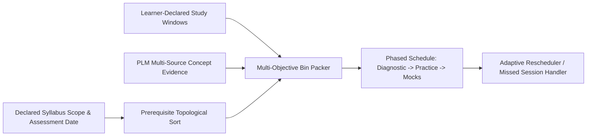

# PREPARATION PLAN ALGORITHM AND ACCEPTANCE TEST SUITE
**Document ID:** GPL-SPEC-ALG-V1  
**Project:** Gramin PocketLab — K–12 Multi-Board Learning Ecosystem  
**Target Audience:** QA Engineers, Algorithmic Developers, Systems Architects  
**Status:** Draft — Task v6 Security, Validation & Evidence Reconciliation Completed
**Classification:** Algorithmic Specification, Mathematical Formulations & Acceptance Verification  

---

## 1. Algorithmic Architecture & Mathematical Foundations

The **Intelligent Preparation Planner** solves a constrained multi-objective bin-packing problem: mapping a set of curricular topic tasks $\mathcal{T} = \{t_1, t_2, \dots, t_m\}$ into a sequence of discrete, learner-declared available study blocks $\mathcal{S} = \{s_1, s_2, \dots, s_n\}$ across $D$ days preceding an assessment, while strictly respecting prerequisite DAG dependencies and cognitive fatigue thresholds.

---

## 2. Unified Mathematical Formulations

### 2.1 Topic Weight & Duration Allocation
For any topic $k \in \mathcal{T}$, total allocated study duration $T(k)$ is defined by:

$$T(k) = T_{\text{base}}(k) \cdot \mu_{\text{diff}}(k) \cdot \omega_{\text{state}}(k) \cdot \psi_{\text{marks}}(k)$$

Where:
- $T_{\text{base}}(k) \in [20, 45]\text{ minutes}$ (Baseline curriculum standard duration).
- $\mu_{\text{diff}}(k) \in \{1.0 \text{ [Foundational]}, 1.3 \text{ [Standard]}, 1.6 \text{ [Advanced]}\}$.
- $\omega_{\text{state}}(k)$ is derived from the student's Personal Learning Model (PLM):
  $$\omega_{\text{state}}(k) = \begin{cases} 
  1.8 & \text{if } \text{State} = \text{'not\_yet\_explored'} \\
  1.5 & \text{if } \text{State} \in \{\text{'learning'}, \text{'review\_recommended'}\} \\
  1.0 & \text{if } \text{State} = \text{'practising'} \\
  0.6 & \text{if } \text{State} = \text{'strong\_recent\_evidence'} 
  \end{cases}$$
- $\psi_{\text{marks}}(k) = 1.0 + 0.5 \cdot \left(\frac{\text{TopicExamWeightMarks}}{\text{TotalExamMarks}}\right)$ (Prioritizes heavily-weighted topics).

### 2.2 Task Phase Decomposition
Each topic's allocated duration $T(k)$ is partitioned across four pedagogical phases:
1. **Phase 1: Diagnostic & Concept Exploration (30% of allocated buffer):** Interactive QuestionWorld + Socratic conceptual inquiry.
2. **Phase 2: Worked Examples & Guided Practice (30% of allocated buffer):** Structured problem solving, step-by-step worked examples, boundary manipulation.
3. **Phase 3: Retrieval Practice & Misconception Remediation (25% of allocated buffer):** Unassisted active retrieval practice, targeted diagnostic error triggers.
4. **Phase 4: Spaced Recall & Synthesis Simulation (15% of allocated buffer):** Spaced revision across expanding intervals, mixed-practice review, timed mock assessment simulation.

### 2.3 Topological Prerequisite Ordering
Let $G = (V, E)$ be the directed acyclic graph (DAG) of topic prerequisites where $(u, v) \in E$ denotes that topic $u$ is a prerequisite for topic $v$. The scheduler performs a topological sort:

$$\text{TopologicalIndex}(u) < \text{TopologicalIndex}(v) \quad \forall (u, v) \in E$$

Tasks for topic $u$ must be scheduled in study slots strictly prior to tasks for topic $v$.

### 2.4 Rescheduling & Guaranteed Scope Protection

> [!CRITICAL]
> **Zero Silent Pruning Guarantee:**
> If total declared study availability is insufficient to cover all topics deeply:
> 1. The scheduler **never** silently removes or rewrites any declared topic from the student's assessment scope.
> 2. All declared topics remain visible in the study plan.
> 3. Available minutes are allocated to foundational prerequisites and high-yield topics first; topics with insufficient time are flagged with a prominent alert: `[Insufficient study time: Condensed concept review only]`.
> 4. The student retains full decision agency to expand study windows, accept condensed reviews, or consult their teacher.

When a scheduled study slot of duration $\Delta t$ is missed:
- **Case A ($\text{AvailableBuffer} \ge \Delta t$):** Shifts uncompleted tasks into remaining buffer slots without increasing daily capacity.
- **Case B ($\text{AvailableBuffer} < \Delta t$):** Compresses Phase 4 optional revision from topics with `strong_recent_evidence` and presents the student with transparent choices:
  1. Add an extra study window on an upcoming rest day.
  2. Accept condensed summary reviews for lower-yield topics while preserving deep practice on core concepts.

---

## 3. Algorithmic Acceptance Test Scenarios (10 Scenarios)

The following 10 test specifications define the required behavioral contracts for the preparation engine.

### Test Case 1: Canonical 7-Day Single-Subject Unit Test Plan
* **Inputs:**
  * Assessment: CBSE Class 10 Mathematics Unit Test (Real Numbers + Polynomials).
  * Days Remaining: 7 days.
  * Timetable: Monday–Friday 60 mins/day declared study; Saturday 120 mins; Sunday protected rest day.
  * PLM State: Real Numbers = `strong_recent_evidence`; Polynomials = `not_yet_explored`.
* **Expected Output:**
  * Days 1–3: Polynomials Phase 1 (QuestionWorld) + Phase 2 (Worked Examples).
  * Day 4: Polynomials Phase 3 (Retrieval practice).
  * Day 5: Real Numbers (Phase 4 refresher: 20 mins) + Polynomials synthesis.
  * Day 6 (Saturday): Full Timed Mock Unit Test (45 mins) + targeted mistake review.
  * Day 7 (Sunday): Zero mandatory tasks; light formula sheet review only.
* **Pass Criteria:** Polynomials allocated $>65\%$ of total time; Sunday preserved as off-day; zero prerequisite inversions.
* **Execution Status:** `Test Specification — Algorithm Implementation Pending Build Window`.

### Test Case 2: Multi-Subject Assessment Interleaving
* **Inputs:**
  * Assessment: Combined Half-Yearly (Physics 40 marks + Chemistry 40 marks).
  * Days Remaining: 10 days. Total topics: 6 Physics, 6 Chemistry.
  * Timetable: 90 mins/day declared study time across two 45-minute blocks.
* **Expected Output:**
  * Daily slots interleave Physics and Chemistry blocks to prevent subject fatigue.
  * High-cognitive-load derivation tasks scheduled in alert study windows; vocabulary and classification tasks scheduled in secondary windows.
* **Pass Criteria:** Max daily allocation per subject $\le 60\text{ mins}$; both subjects conclude Phase 3 practice before Day 8.
* **Execution Status:** `Test Specification — Algorithm Implementation Pending Build Window`.

### Test Case 3: Acute Time Crunch (<36 Hours to Assessment)
* **Inputs:**
  * Assessment: Class 8 Science Chapter Quiz in 36 hours.
  * Scope: 3 Chapters (Sound, Microorganisms, Combustion).
  * Timetable: 2 hours total declared study time available.
* **Expected Output:**
  * Emergency Triage Mode: Preserves all 3 chapters in view.
  * Schedules high-yield Diagnostic Check (20 mins) $\rightarrow$ Targeted Misconception Review (40 mins) $\rightarrow$ High-Frequency Exit Check (40 mins) $\rightarrow$ Core Formula Sheet (20 mins).
  * Flags topics with alert: `[Condensed Exam Preparation Mode: Deep sandboxes bypassed]`.
* **Pass Criteria:** Zero schedule failure; total duration strictly clamped to 120 mins; highlights top historical misconceptions.
* **Execution Status:** `Test Specification — Algorithm Implementation Pending Build Window`.

### Test Case 4: Missed Study Session Adaptive Reschedule (Non-Punitive)
* **Inputs:**
  * Student scheduled for 60 mins Biology on Wednesday; zero app interaction recorded (student attended family commitment).
  * App opened Thursday morning.
* **Expected Output:**
  * Welcoming banner: *"Good morning! Would you like to adjust your study plan for the remaining days?"*
  * Zero negative language; streak counter unaffected.
  * Wednesday's 60-min task split into 30 mins Thursday and 30 mins Friday using unallocated buffer.
* **Pass Criteria:** Rescheduling completes in $<100\text{ ms}$; user confirmation required before committing change.
* **Execution Status:** `Test Specification — Algorithm Implementation Pending Build Window`.

### Test Case 5: Overburdened Learner Scope Protection & Capacity Clamping
* **Inputs:**
  * Student enters 6 subjects for Term Finals with 24 chapters total; 5 days remaining; available study capacity = 60 mins/day.
* **Expected Output:**
  * System **refuses to drop any chapter silently**.
  * Displays prominent deficit advisory: *"Studying 24 chapters in 5 hours allows only 12.5 minutes per chapter."*
  * Prioritizes foundational prerequisites and heavily-weighted chapters with 4-phase schedules; flags remaining chapters as `[Condensed Review]`.
* **Pass Criteria:** System strictly refuses to exceed user's declared daily capacity; zero declared topics pruned.
* **Execution Status:** `Test Specification — Algorithm Implementation Pending Build Window`.

### Test Case 6: Prerequisite Dependency Enforcement
* **Inputs:**
  * Student selects Class 11 Physics "Rotational Dynamics", but PLM indicates Class 11 "Linear Kinematics & Newton's Laws" has state `review_recommended` with unresolved force misconceptions.
* **Expected Output:**
  * Plan schedules a 25-minute "Foundation Repair" block for Newton's 2nd Law & Torque before initiating Rotational Inertia QuestionWorlds.
* **Pass Criteria:** Prerequisite topic scheduled strictly before dependent topic.
* **Execution Status:** `Test Specification — Algorithm Implementation Pending Build Window`.

### Test Case 7: Spaced Retrieval Interval Verification (Heuristic Scheduling)
* **Inputs:**
  * Topic A practiced successfully on Day 1.
  * 14-day study plan.
* **Expected Output:**
  * Phase 4 Retrieval Practice placed on Day 4 (3 days later) and Day 10 (6 days later) based on configurable heuristic review intervals.
* **Pass Criteria:** Intervals conform to expanding review sequence ($\Delta t_1 \approx 3\text{ days}, \Delta t_2 \approx 6\text{ days}$).
* **Execution Status:** `Test Specification — Algorithm Implementation Pending Build Window`.

### Test Case 8: Fragmented Learner-Declared Study Slots
* **Inputs:**
  * Student timetable has fragmented declared study windows: 20 mins morning, 45 mins evening.
* **Expected Output:**
  * 20 mins morning: Quick retrieval practice / vocabulary check.
  * 45 mins evening: Deep problem-solving / derivation calculations.
* **Pass Criteria:** No 45-minute deep derivation scheduled into a 20-minute morning window.
* **Execution Status:** `Test Specification — Algorithm Implementation Pending Build Window`.

### Test Case 9: Sudden Assessment Postponement
* **Inputs:**
  * Assessment scheduled for Friday postponed by school to next Wednesday (+5 days).
* **Expected Output:**
  * Plan expands automatically. Converts upcoming Thursday into relaxed mock test. Inserts maintenance spaced retrieval across the extra 5 days.
* **Pass Criteria:** Prevents premature completion; maintains concept retention across the extended window.
* **Execution Status:** `Test Specification — Algorithm Implementation Pending Build Window`.

### Test Case 10: Zero-Network Offline Plan Recalculation
* **Inputs:**
  * Device in Airplane Mode; student changes daily available study time from 90 mins to 60 mins.
* **Expected Output:**
  * Pure client-side JavaScript execution in $<50\text{ ms}$ (acceptance performance target).
  * Plan regenerated and saved to IndexedDB; zero network requests attempted.
* **Pass Criteria:** 100% offline functionality verified.
* **Execution Status:** `Test Specification — Acceptance Target for Client-Side Engine`.

---

## 4. Separation of Acceptance Targets vs. Executed Test Results

> [!IMPORTANT]
> **Quality Gate Integrity Rule:**
> In accordance with technical review standards, acceptance targets and architectural specifications must never be reported as passed test results without an explicit execution record:

| Category | Description | Scope in Repository | Current Status |
| :--- | :--- | :--- | :---: |
| **Acceptance Target** | Measurable engineering goal (e.g. sub-50ms plan generation, 60 FPS rendering, $<250\text{ KB}$ bundle). | Target criteria across all 10 specifications | `Target Standard (Unverified)` |
| **Test Specification** | Formal test inputs, preconditions, and pass/fail criteria (e.g. Test Cases 1–10 above). | Defined in Section 3 above | `Specification Complete (Ready for Implementation)` |
| **Executed Automated Tests** | Unit and contract tests actively executed in the Node.js test runner. | 5 test suites in `tests/` (41 passing subtests) | `41 / 41 Tests Executed & Passed` |
| **Physical Hardware Benchmarks** | Tests on physical Android mobile devices measuring battery, thermal, and audio SPL levels. | Real-device hardware testing | `Pending Hackathon Build Window` |
