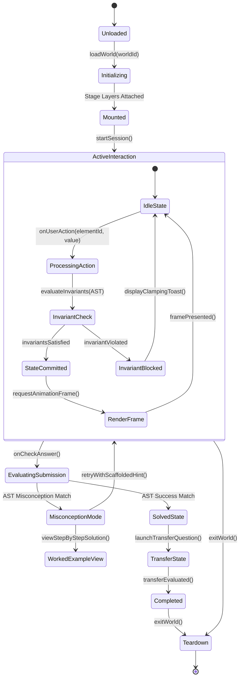

# QUESTION WORLD SCHEMA AND RENDERER SPECIFICATION
**Document ID:** GPL-SPEC-QW-V1  
**Project:** Gramin PocketLab — K–12 Multi-Board Learning Ecosystem  
**Target Audience:** Systems Architects, UI/UX Engineers, Learning Designers, Content Authors  
**Status:** Draft — Task v6 Security, Validation & Evidence Reconciliation Completed
**Classification:** Technical Architecture, Safety Contract & Declarative Schema Specification  

---

## 1. Executive Summary & Philosophy

In conventional educational applications, questions are presented as flat, passive cards: static text, multiple-choice radio buttons, and a colored feedback toast. This model fails to engage deep conceptual faculties and reduces learning to rote memorization.

**Gramin PocketLab replaces question cards with QuestionWorlds.**

A **QuestionWorld** is a self-contained, interactive cognitive microcosm designed around a specific learning objective. When a student encounters a problem, they do not just read about a concept—they enter an environment built specifically for that concept:
- In **Mathematics**, they enter an architectural studio to manipulate coordinate vertices, or a marketplace to optimize trade ratios.
- In **Physics**, they enter a resonance chamber or an optical bench where manipulating wave controls directly alters sensory and mathematical feedback.
- In **Chemistry**, they step into a reaction workbench with molecular manipulatives, temperature controls, and indicator dynamics.
- In **Biology**, they investigate living ecosystems, cellular membranes, or genetic crosses through real-time state machines.
- In **Social Sciences & Humanities**, they navigate dynamic cartographic timelines, analyze archival source fragments, or balance municipal budgets.

Every visual interaction in a QuestionWorld serves a clear educational purpose. Spectacle is never prioritized over conceptual clarity.

---

## 2. Declarative Rule Engine & Canonical AST Types

> [!IMPORTANT]
> **Prohibition of Dynamic Code Execution (P0 Security Mandate):**
> QuestionWorlds are strictly declarative documents. Content definitions **must never contain raw JavaScript code strings, lambda functions, or dynamic expressions**. Evaluation of system invariants, misconception triggers, and answer criteria is executed entirely through a deterministic, sandboxed **Abstract Syntax Tree (AST) Condition Engine**. Dynamic evaluation mechanisms (`eval()`, `new Function()`, `setTimeout(string)`, or inline scripts) are strictly prohibited and blocked by Content Security Policy (CSP).

### 2.1 Canonical Declarative AST Schema (v1.0.0)

All condition trees across QuestionWorlds, invariants, misconception triggers, and validation harnesses adhere to exactly one canonical AST node shape.

```typescript
/**
 * Canonical Declarative AST Schema
 * Version: 1.0.0
 * Status: Authoritative Architecture Specification
 */

export type ASTNodeType = 'logical' | 'comparison' | 'variable' | 'literal';

export type LogicalOperator = 'AND' | 'OR' | 'NOT';

export type ComparisonOperator = 
  | 'EQ'      // Equal (===)
  | 'NEQ'     // Not Equal (!==)
  | 'LT'      // Less Than (<)
  | 'LTE'     // Less Than or Equal (<=)
  | 'GT'      // Greater Than (>)
  | 'GTE'     // Greater Than or Equal (>=)
  | 'IN'      // Included in candidate array
  | 'BETWEEN';// Numerically between [min, max] inclusive

export type LiteralValueType = 'number' | 'string' | 'boolean';

export interface CanonicalASTVariableNode {
  nodeType: 'variable';
  path: string; // Non-empty declared state path, e.g., 'plots.plot1'
}

export interface CanonicalASTLiteralNode {
  nodeType: 'literal';
  valueType: LiteralValueType;
  value: number | string | boolean; // Finite numbers only; NaN/Infinity strictly prohibited
}

export type CanonicalASTValueNode = CanonicalASTVariableNode | CanonicalASTLiteralNode;

export interface CanonicalASTLogicalNode {
  nodeType: 'logical';
  operator: LogicalOperator;
  children: CanonicalASTConditionNode[]; // AND/OR require >= 2 children; NOT requires exactly 1 child
}

export interface CanonicalASTComparisonNode {
  nodeType: 'comparison';
  operator: ComparisonOperator;
  left: CanonicalASTValueNode;
  right: CanonicalASTValueNode | CanonicalASTValueNode[]; // Array for IN (>= 1) and BETWEEN (exactly 2 [min, max])
}

export type CanonicalASTConditionNode = CanonicalASTLogicalNode | CanonicalASTComparisonNode;
```

---

## 3. QuestionWorld Data Schema (TypeScript Definition)

The formal contract for defining, storing, and loading a QuestionWorld is specified below. All QuestionWorld definitions are immutable JSON-serializable documents validated at build time against a strict JSON Schema.

```typescript
/**
 * Formal schema definition for Gramin PocketLab QuestionWorlds.
 * Version: 2.0.0
 */

// NCF-SE 2023 Developmental Stages
export type EducationalStage = 
  | 'preparatory_grade_5'           // Preparatory Stage (Classes 3-5; Class 5 is final year)
  | 'middle_grades_6_8'             // Middle Stage (Classes 6-8)
  | 'secondary_grades_9_10'         // Secondary Stage (Classes 9-10)
  | 'senior_secondary_grades_11_12';// Senior Secondary / Higher Secondary (Classes 11-12)

export type CognitiveDomain = 'remember' | 'understand' | 'apply' | 'analyze' | 'evaluate' | 'create';

export type DifficultyLevel = 'foundational' | 'standard' | 'advanced' | 'olympiad_challenge';

/**
 * Strict separation of Examining Authority, Framework, Route, and Textbook Alignment.
 * NCERT is classified under Textbook Alignment, NOT as an examining board.
 * ICSE and ISC are classified as examination routes under the CISCE authority.
 */
export interface CurriculumCoordinates {
  // Examining / Curriculum Authority (Official State or National Board)
  curriculumAuthorityId: 'CBSE' | 'CISCE' | 'KSEAB' | 'MSBSHSE' | 'UPMSP' | 'STATE_BOARD_GENERIC';
  
  // Governing National or State Curriculum Framework
  curriculumFramework: 'NCF_SE_2023' | 'STATE_CURRICULUM_FRAMEWORK' | 'LEGACY_NCF_2005';
  
  // Official Examination Route / Stage
  examinationRoute?: 
    | 'CBSE_CLASS_X' 
    | 'CBSE_CLASS_XII' 
    | 'CISCE_ICSE_X' 
    | 'CISCE_ISC_XII' 
    | 'STATE_SSLC_X' 
    | 'STATE_PUC_XII' 
    | 'INTERNAL_SCHOOL_ASSESSMENT';

  academicSession: string;          // e.g., '2026-2027'
  classGrade: number;              // 5 through 12
  subjectCode: string;             // Official Board code, e.g., 'MATH_041', 'SCI_086'
  subjectTitle: string;            // e.g., 'Science', 'Mathematics', 'Physics'
  
  // Topic Hierarchy
  chapterNumber: number;           // e.g., 7
  chapterTitle: string;            // e.g., 'Acids, Bases and Salts'
  topicId: string;                 // e.g., 'indicators_and_ph_scale'
  subtopicId?: string;             // e.g., 'turmeric_natural_indicator'

  // Specific Textbook Source & Publisher Alignment
  textbookAlignment: {
    textbookPublisher: 'NCERT' | 'STATE_TEXTBOOK_SOCIETY' | 'BOARD_AUTHORIZED_PRIVATE' | 'CUSTOM';
    textbookTitle: string;         // e.g., 'Science: Textbook for Class VII'
    editionOrReprintYear: string;  // e.g., 'Rationalised 2024-25 Edition'
    languageMedium: 'en' | 'hi' | 'kn' | 'ta' | 'te' | 'mr';
    isbn?: string;                 // e.g., '978-81-7450-XXX-X'
  };

  learningStandardRef?: string;     // e.g., 'NCERT.SCI.7.5.2'
}

export interface AccessibilityAlternative {
  ariaLabel: string;
  screenReaderDescription: string;
  textEquivalentSummary: string;
  dataTableRowHeaders?: string[];
  dataTableRows?: (string | number)[][];
  highContrastColorOverrides?: Record<string, string>;
  prefersReducedMotionSnapshotUri?: string;
  keyboardShortcutMap?: Record<string, string>; // e.g., { 'ArrowUp': 'Increment Stepper' }
}

export interface InteractiveElement {
  elementId: string;
  type: 'stepper' | 'slider' | 'toggle' | 'drag_target' | 'canvas_node' | 'audio_emitter' | 'switch';
  labelKey: string;
  defaultValue: number | string | boolean;
  minValue?: number;
  maxValue?: number;
  step?: number;
  options?: { value: string; labelKey: string }[];
  targetVariable: string;          // Bound local variable in worldState
  ariaRole: string;
  touchTargetMinPx: number;        // Must be >= 48px (>= 56px in Class 5)
}

export interface SystemInvariant {
  invariantId: string;
  condition: CanonicalASTConditionNode;  // Evaluated AST condition: MUST evaluate to true
  enforcementType: 'clamp' | 'soft_warning' | 'validation_block';
  errorMessageKey: string;
}

export interface MisconceptionFeedback {
  misconceptionId: string;
  triggerCondition: CanonicalASTConditionNode; // Evaluated AST condition identifying error
  pedagogicalDiagnostic: string;
  studentFacingExplanation: string;
  visualCueHighlightElementId?: string;
  scaffoldedHint: string;
  cognitiveRemediationType: 'counterexample' | 'boundary_contrast' | 'causal_chain' | 'concrete_manipulative';
}

export interface QuestionWorldDefinition {
  // 1. Identity & Provenance
  worldId: string;                         // Unique UUID v4 or namespaced slug (e.g., 'QW-CHM-07-01')
  schemaVersion: '2.0.0';
  provenance: {
    author: string;
    curriculumReviewer: string;
    license: 'CC-BY-NC-4.0' | 'MIT' | 'PROPRIETARY_GRAMIN';
    sourceTextbookEdition: string;
    contentHashSha256: string;
  };

  // 2. Curricular & Pedagogical Context
  curriculum: CurriculumCoordinates;
  cognitiveDomain: CognitiveDomain;
  difficulty: DifficultyLevel;
  targetStage: EducationalStage;
  learningObjective: string;
  estimatedCompletionMinutes: number;

  // 3. Narrative & Thematic Environment
  worldTitle: string;
  thematicIdentity: {
    worldSetting: string;                  // e.g., 'Natural Dye Laboratory'
    characterGuide?: {
      name: string;
      avatarSvg: string;
      roleTitle: string;
    };
    audioAmbience?: {
      soundscapeId: string;
      volumeCeiling: number; // Maximum 0.20 for gentle non-distracting sound
      autoplay: false;      // Mandatory false: zero autoplay
    };
  };

  // 4. Visual Stage & Models
  visualEnvironment: {
    rendererType: 'dom_svg' | 'canvas_2d' | 'hybrid' | 'webgl_experimental';
    viewportAspectRatio: '4:3' | '16:9' | 'responsive_flow';
    canvasHeight: number;                  // Logical base height in pixels, e.g., 450 (width derived dynamically from viewportAspectRatio or container)
    themeTokens: Record<string, string>;   // Theme CSS token overrides
    sceneObjects: {
      id: string;
      type: 'rect' | 'circle' | 'path' | 'text' | 'group' | 'custom_canvas';
      initialProps: Record<string, any>;
      reactiveBindings: Record<string, string>; // Maps worldState variables to object properties
    }[];
  };

  // 5. Interactive Mechanics
  interactiveElements: InteractiveElement[];
  systemInvariants: SystemInvariant[];

  // 6. Educational Problem & Evaluation
  problemStatement: {
    promptText: string;
    instructions: string[];
    contextualDataPills?: { label: string; value: string }[];
  };

  evaluationEngine: {
    evaluationType: 'declarative_ast_match' | 'discrete_choice' | 'numeric_target';
    successCondition: DeclarativeCondition; // AST condition defining correctness
    discreteOptions?: {
      optionId: string;
      labelKey: string;
      associatedMisconceptionId?: string;
    }[];
    tolerance?: number;                     // For floating-point approximations
  };

  // 7. Scaffolding, Feedback & Remediation
  misconceptionHandlers: MisconceptionFeedback[];
  progressiveHints: {
    hintLevel: 1 | 2 | 3;
    hintText: string;
    unlockedByActionOrTime?: string;
  }[];
  workedExample: {
    stepByStepSolution: string[];
    pedagogicalKeyInsight: string;
  };
  transferQuestion: {
    transferQuestionId: string;
    promptText: string;
    options: { optionId: string; labelText: string; isCorrect: boolean }[];
    explanationText: string;
  };

  // 8. Accessibility & Resilience
  accessibility: AccessibilityAlternative;
  performanceBudget: {
    maxBundleSizeBytes: number; // Strict <= 256 KB
    maxFrameDrawMs: number;     // Strict <= 16.6 ms (60 FPS on 2GB RAM device)
    offlineCacheRequired: true;
  };
}
```

---

## 4. Sandbox Security Boundary & Execution Isolation Contract (Architectural Proposal)

> [!CAUTION]
> **Defense-in-Depth Isolation Specification:**
> Calling an architecture "sandboxed" or "secure" without defining formal isolation parameters is insufficient. An `<iframe>` alone does not guarantee absolute isolation from every browser or microarchitectural host risk (such as transient-execution side channels or shared-process resource contention). 
> 
> The QuestionWorld renderer isolation model is a **formal architectural proposal** implementing four defense-in-depth layers to isolate untrusted interactive content from sensitive parent application state (learner profiles, encryption keys, personal learning models, and timetables).

```
+---------------------------------------------------------------------------------+
| LAYER 4: HOST APPLICATION SHELL (PWA Core / Store / Router / IndexedDB)         |
|   - Holds learner profiles, study schedules, encryption keys, personal model    |
|   - Origin: https://app.graminpocketlab.org (or standalone PWA origin)          |
+---------------------------------------------------------------------------------+
                                       │
                  [ Strict Opaque-Origin Boundary ]
                  [ Nonce-Authenticated postMessage Protocol ]
                  [ Zero Storage / Zero Network API Access ]
                                       ▼
+---------------------------------------------------------------------------------+
| LAYER 3: OPAQUE-ORIGIN IFRAME CONTAINER (sandbox="allow-scripts")               |
|   - Origin: Opaque unique origin (origin === "null")                            |
|   - Prohibits allow-same-origin, allow-top-navigation, allow-popups, forms      |
+---------------------------------------------------------------------------------+
                                       │
                  [ Content Security Policy Enforcement ]
                  [ connect-src 'none', script-src 'self' 'nonce-{NONCE}' ]
                                       ▼
+---------------------------------------------------------------------------------+
| LAYER 2: BOUNDED AST CONDITION EVALUATOR (Deterministic Pure Tree-Walk)         |
|   - Evaluates Canonical AST JSON conditions (max depth 8, max nodes 64)         |
|   - Zero dynamic code evaluation: eval(), new Function(), setTimeout(str) BANNED|
+---------------------------------------------------------------------------------+
                                       │
                  [ Local State Partitioning ]
                  [ Read/Write ONLY to declared worldState variables ]
                                       ▼
+---------------------------------------------------------------------------------+
| LAYER 1: VIEWPORT STAGE PRIMITIVES (Canvas 2D / Static SVG Stage)                |
|   - Bounded execution budget: <= 5ms per tick, <= 16.6ms per frame render       |
|   - Auto-throttles to static display if frame budget is exceeded                |
+---------------------------------------------------------------------------------+
```

### 4.1 Strict Content Security Policy (CSP) Directives

The renderer document is served or loaded with an uncompromising Content Security Policy. Dynamic code generation strings such as `'unsafe-eval'` and unhashed inline scripts (`'unsafe-inline'`) are strictly prohibited.

```http
Content-Security-Policy: default-src 'none'; script-src 'self' 'nonce-{SESSION_NONCE}'; style-src 'self' 'nonce-{SESSION_NONCE}'; img-src 'self' data:; media-src 'self' data:; connect-src 'none'; object-src 'none'; base-uri 'none'; frame-src 'none'; form-action 'none'; worker-src 'none';
```

#### Directive Explanations & Justifications
1. `default-src 'none'`: Denies all resources by default.
2. `script-src 'self' 'nonce-{SESSION_NONCE}'`: Permits only bundled first-party renderer scripts matching the per-session cryptographically random nonce. Dynamic evaluation (`'unsafe-eval'`) and unvalidated inline scripts (`'unsafe-inline'`) are strictly blocked.
3. `style-src 'self' 'nonce-{SESSION_NONCE}'`: Permits only theme styles bearing the per-session nonce.
4. `connect-src 'none'`: Strictly blocks all outbound network requests (`fetch()`, `XMLHttpRequest`, `WebSocket`, `EventSource`, `sendBeacon()`, and WebRTC). The QuestionWorld renderer has zero network capability.
5. `object-src 'none'`: Blocks browser plugins (Flash, Java, Silverlight).
6. `base-uri 'none'`: Prevents `<base>` tag injection attacks that alter relative URL resolution.
7. `frame-src 'none'` & `worker-src 'none'`: Blocks nesting child iframes and spawning Web Workers, SharedWorkers, or ServiceWorkers.
8. `form-action 'none'`: Blocks `<form>` submissions.

---

### 4.2 Iframe Sandbox Attributes & Origin Strategy

The QuestionWorld iframe is embedded using strictly bounded attributes:

```html
<iframe 
  id="qw-stage-frame"
  src="/renderer/sandbox_stage.html"
  sandbox="allow-scripts"
  csp="default-src 'none'; script-src 'self' 'nonce-RANDOM'; connect-src 'none';"
  title="QuestionWorld Interactive Microcosm"
  loading="lazy">
</iframe>
```

#### Permitted Attribute Justification
- `allow-scripts`: Strictly required to execute the bundled client-side stage renderer, reactive state machine, and declarative AST reference evaluator.

#### Denied Attributes & Security Implications
- `allow-same-origin` (DENIED): Omission of `allow-same-origin` forces the iframe into an **opaque unique origin** (`origin === "null"`). Consequently:
  - The renderer cannot access `window.parent` DOM, global variables, or functions.
  - The renderer cannot access `localStorage`, `sessionStorage`, or `IndexedDB` of the parent application origin.
  - The renderer cannot read or write `document.cookie`.
- `allow-top-navigation`, `allow-top-navigation-by-user-activation` (DENIED): Blocks iframe scripts from hijacking or navigating the parent window.
- `allow-popups`, `allow-popups-to-escape-sandbox` (DENIED): Blocks opening new windows, tabs, or modal alerts.
- `allow-forms` (DENIED): Prevents form submissions.
- `allow-modals` (DENIED): Blocks `window.alert()`, `window.confirm()`, and `window.prompt()`.
- `allow-downloads` (DENIED): Blocks triggering file downloads.

---

### 4.3 Safe postMessage Protocol Across Opaque Origins

Because the renderer executes in an opaque unique origin, browser messaging requires specialized defense-in-depth authentication:

1. **Origin Ambiguity in Opaque Sandboxes:** When an iframe lacks `allow-same-origin`, its `event.origin` string is serialized by browsers as `"null"`. The parent window cannot rely on `if (event.origin === "https://app.graminpocketlab.org")` to verify message authenticity.
2. **Wildcard Target Origin Constraint:** When the parent dispatches messages to an opaque iframe (`iframe.contentWindow.postMessage(msg, "*")`), the target origin must be set to `"*"`. **A wildcard target origin MUST NEVER be treated as authentication.**
3. **Session Nonce Authentication:** At iframe instantiation, the parent generates a 32-byte cryptographically secure random hexadecimal token (`sessionNonce` via `window.crypto.getRandomValues()`). This nonce is passed to the iframe during initial handshake. Every subsequent message between parent and iframe must carry this exact `sessionNonce` in its payload envelope. Any message bearing an invalid, missing, or mismatched nonce is rejected and triggers immediate container termination.
4. **Source Window Verification:** The parent window listener strictly validates `event.source === iframeElement.contentWindow`. Any message originating from another window or tab is dropped immediately.

#### Strict postMessage Message Envelope Schema (Version 1.0.0)

```typescript
export interface SafePostMessageEnvelope<T = any> {
  protocolVersion: '1.0.0';
  sessionNonce: string;          // 32-byte hex string
  messageId: string;             // UUIDv4
  timestamp: number;             // Unix timestamp in milliseconds
  type: 
    | 'RENDERER_INIT'            // Parent -> Iframe: load world definition & initial state
    | 'STATE_TICK'               // Iframe -> Parent: batched state change notification
    | 'INTERACTION_EVENT'        // Iframe -> Parent: student manipulated a control
    | 'EVAL_CONDITION'           // Parent -> Iframe: evaluate invariant/misconception
    | 'EVAL_RESULT'              // Iframe -> Parent: boolean evaluation result
    | 'RENDERER_HEARTBEAT'       // Bidirectional keepalive ping/pong
    | 'RENDERER_ERROR';          // Iframe -> Parent: runtime exception or boundary breach
  payload: T;
}
```

#### Protocol Controls & Quotas
- **Payload Size Ceiling:** Message payload serialization is capped at **64 KB**. Messages exceeding 64 KB are discarded, and an error is logged.
- **Message Rate Limiting:** A sliding window restricts messaging to a maximum of **60 messages per second**. Bursts exceeding this quota trigger message throttling.
- **Fail-Closed Rejection:** If a message fails schema validation, carries an invalid nonce, or violates payload limits, the receiver silently drops the message, logs a security anomaly, and if repeated, terminates the iframe container.

---

### 4.4 Resource & Evaluation Limits (Fail-Closed Governance)

To prevent denial-of-service, UI freeze, or memory exhaustion on low-end devices:

| Metric / Parameter | Strict Upper Limit | Enforcement Action on Breach |
| :--- | :---: | :--- |
| **AST Tree Depth** | 8 levels | Static validation failure; condition evaluates to `false` (Fail-Closed). |
| **AST Node Count** | 64 nodes per tree | Static validation failure; condition evaluates to `false` (Fail-Closed). |
| **Evaluation Step Budget** | 128 ops per tick | Runtime abort; condition returns `false`; emits `RENDERER_ERROR`. |
| **Interaction Tick Duration**| 5.0 milliseconds | Script execution throttled; non-essential visual transitions deferred. |
| **Render Frame Budget** | 16.6 milliseconds (60 FPS) | Frame dropper; if $>3$ consecutive frames exceed 33ms, switches to low-overhead 2D mode. |
| **WorldState Payload Size** | 32 Kilobytes | State mutation rejected; resets variable to prior valid state. |

---

### 4.5 Trade-Offs & Limitations of Iframe Sandboxing

Architectural honesty requires recognizing the inherent limitations of client-side web sandboxes:
1. **Shared Process & Side Channels:** In standard mobile browsers, same-site iframes may share the same OS rendering process. While the opaque origin prevents DOM and storage access, it does not prevent microarchitectural side-channel attacks (e.g., Spectre) without cross-origin process isolation headers (`Cross-Origin-Opener-Policy: same-origin` and `Cross-Origin-Embedder-Policy: require-corp`).
2. **Resource Starvation:** A malicious or infinite loop in an iframe can saturate the JavaScript main thread because JavaScript is single-threaded per event loop. The 5ms computation budget and AST node depth restrictions are the primary defense against main-thread denial-of-service.
3. **Future Production Architecture:** For production multi-tenant deployments hosting untrusted user-authored content, QuestionWorlds will be hosted on an isolated distinct domain (e.g., `https://sandbox.graminpocketlab.org`) to guarantee out-of-process process isolation at the OS level.

---

## 5. Declarative AST Reference Evaluator (Specification Test Harness)

> [!NOTE]
> **Specification Test Harness Boundary:**
> The following implementation is a standalone reference evaluator and specification test harness. It is validated against the canonical test fixtures in `TASK_V6_AST_FIXTURES.json` via `TASK_V6_AST_VALIDATOR.py`. It is NOT an implemented application runtime.

```javascript
/**
 * Canonical AST Reference Evaluator (Specification v1.0.0)
 * Evaluates strictly typed CanonicalASTConditionNode trees.
 */
export function evaluateCanonicalCondition(node, state, declaredSchema, depth = 1, counter = { ops: 0 }) {
  if (!node || typeof node !== 'object') {
    throw new Error('[INVALID_NODE] Condition node must be an object');
  }

  if (depth > 8) {
    throw new Error('[EXCESSIVE_DEPTH] Tree depth exceeds maximum of 8');
  }

  counter.ops += 1;
  if (counter.ops > 128) {
    throw new Error('[OPERATION_QUOTA_EXCEEDED] Operation count exceeded limit of 128');
  }

  if (node.nodeType === 'logical') {
    const { operator, children } = node;
    if (!Array.isArray(children)) throw new Error('[INVALID_LOGICAL_CHILDREN] Children must be an array');
    
    if (operator === 'AND') {
      if (children.length < 2) throw new Error('[EMPTY_LOGICAL_CHILD_LIST] AND requires >= 2 children');
      return children.every(child => evaluateCanonicalCondition(child, state, declaredSchema, depth + 1, counter));
    }
    if (operator === 'OR') {
      if (children.length < 2) throw new Error('[EMPTY_LOGICAL_CHILD_LIST] OR requires >= 2 children');
      return children.some(child => evaluateCanonicalCondition(child, state, declaredSchema, depth + 1, counter));
    }
    if (operator === 'NOT') {
      if (children.length !== 1) throw new Error('[INVALID_LOGICAL_CHILDREN] NOT requires exactly 1 child');
      return !evaluateCanonicalCondition(children[0], state, declaredSchema, depth + 1, counter);
    }
    throw new Error(`[UNKNOWN_OPERATOR] Unknown logical operator: ${operator}`);
  }

  if (node.nodeType === 'comparison') {
    const { operator, left, right } = node;
    const leftVal = resolveValueNode(left, state, declaredSchema);

    if (operator === 'BETWEEN') {
      if (!Array.isArray(right) || right.length !== 2) throw new Error('[INVALID_OPERAND_SHAPE] BETWEEN requires [min, max]');
      const minVal = resolveValueNode(right[0], state, declaredSchema);
      const maxVal = resolveValueNode(right[1], state, declaredSchema);
      if (typeof leftVal !== 'number' || typeof minVal !== 'number' || typeof maxVal !== 'number') {
        throw new Error('[TYPE_MISMATCH] BETWEEN operands must be numbers');
      }
      return leftVal >= minVal && leftVal <= maxVal;
    }

    if (operator === 'IN') {
      if (!Array.isArray(right) || right.length < 1) throw new Error('[INVALID_OPERAND_SHAPE] IN requires array');
      const candidates = right.map(r => resolveValueNode(r, state, declaredSchema));
      return candidates.includes(leftVal);
    }

    const rightVal = resolveValueNode(right, state, declaredSchema);
    if (typeof leftVal !== typeof rightVal) {
      throw new Error(`[TYPE_MISMATCH] Cannot compare ${typeof leftVal} with ${typeof rightVal}`);
    }

    switch (operator) {
      case 'EQ': return leftVal === rightVal;
      case 'NEQ': return leftVal !== rightVal;
      case 'LT': return leftVal < rightVal;
      case 'LTE': return leftVal <= rightVal;
      case 'GT': return leftVal > rightVal;
      case 'GTE': return leftVal >= rightVal;
      default: throw new Error(`[UNKNOWN_OPERATOR] Unknown comparison operator: ${operator}`);
    }
  }

  throw new Error(`[INVALID_NODE_TYPE] Unknown condition nodeType: ${node.nodeType}`);
}

function resolveValueNode(node, state, declaredSchema) {
  if (!node || typeof node !== 'object') throw new Error('[INVALID_VALUE_NODE] Value node must be an object');

  if (node.nodeType === 'literal') {
    const { valueType, value } = node;
    if (valueType === 'number') {
      if (typeof value !== 'number' || !Number.isFinite(value)) throw new Error('[NON_FINITE_NUMBER] Number must be finite');
      return value;
    }
    if (valueType === 'string' && typeof value === 'string') return value;
    if (valueType === 'boolean' && typeof value === 'boolean') return value;
    throw new Error(`[TYPE_MISMATCH] Literal value does not match valueType '${valueType}'`);
  }

  if (node.nodeType === 'variable') {
    const { path } = node;
    if (!path || typeof path !== 'string') throw new Error('[INVALID_VARIABLE_PATH] Variable path must be string');
    if (!declaredSchema || !Object.prototype.hasOwnProperty.call(declaredSchema, path)) {
      throw new Error(`[UNDECLARED_VARIABLE] Variable '${path}' is not declared in state schema`);
    }
    if (!state || !Object.prototype.hasOwnProperty.call(state, path)) {
      throw new Error(`[MISSING_STATE_VALUE] State is missing value for variable '${path}'`);
    }
    const val = state[path];
    const expectedType = declaredSchema[path];
    if (expectedType === 'number' && (typeof val !== 'number' || !Number.isFinite(val))) {
      throw new Error(`[TYPE_MISMATCH] Variable '${path}' expected finite number, got ${val}`);
    }
    if (expectedType === 'string' && typeof val !== 'string') {
      throw new Error(`[TYPE_MISMATCH] Variable '${path}' expected string, got ${typeof val}`);
    }
    if (expectedType === 'boolean' && typeof val !== 'boolean') {
      throw new Error(`[TYPE_MISMATCH] Variable '${path}' expected boolean, got ${typeof val}`);
    }
    return val;
  }

  throw new Error(`[INVALID_VALUE_NODE_TYPE] Value nodeType must be 'literal' or 'variable', got '${node.nodeType}'`);
}
```

---

## 6. Renderer Lifecycle Pipeline & Four-Layer Composite



---

## 7. Performance Budgets & Device Resilience Standards

| Metric | Budget Ceiling | Enforcement & Fallback Strategy |
| :--- | :--- | :--- |
| **World Definition JSON** | $\le 45\text{ KB}$ | Validated by build-time schema linter; Brotli/Gzip compression. |
| **Total Media Assets per World** | $\le 200\text{ KB}$ | Vector SVG exclusively; zero heavy PNG/JPEG raster textures. |
| **Memory Footprint per Active World** | $\le 18\text{ MB}$ | Single canvas buffer reuse; strict GC teardown on unmount. |
| **Frame Render Time** | $\le 16.6\text{ ms}$ ($60\text{ FPS}$) | `requestAnimationFrame` loop auto-throttled when state is idle; auto-degrades to $30\text{ FPS}$ if frame $>14\text{ ms}$. |
| **First Contentful Render** | $\le 120\text{ ms}$ from cache | Pre-cached in CacheStorage via Service Worker manifest. |
| **Offline Availability** | $100\%$ | Operates offline after initial cache installation. |

---

## 8. WebGL / 3D Progressive Policy

> [!IMPORTANT]
> **Gramin PocketLab 2D/SVG-First Engineering Standard:**
> WebGL or 3D rendering is strictly prohibited unless all of the following conditions are met:
> 1. The learning objective fundamentally requires 3D spatial rotation (e.g., stereochemistry chirality or complex crystal lattices in Class 12).
> 2. The device demonstrates hardware acceleration support ($>45\text{ FPS}$ on a 500-poly test mesh).
> 3. An equivalent, fully interactive 2D orthogonal projection exists as an automatic zero-latency fallback for low-tier hardware.
