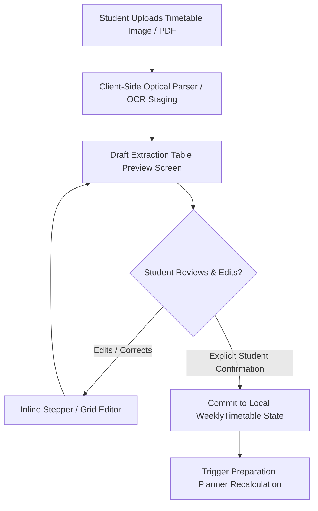

# MY SCHOOL & STUDY HUB SPECIFICATION
**Document ID:** GPL-SPEC-SH-V1  
**Project:** Gramin PocketLab — K–12 Multi-Board Learning Ecosystem  
**Target Audience:** Frontend Engineers, Systems Architects, Product Managers, UI Designers  
**Status:** Draft — Task v6 Security, Validation & Evidence Reconciliation Completed
**Classification:** Core Functional Specification, Data Contracts & Availability Synthesis  

---

## 1. Product Overview & Purpose

A major challenge for Indian school students is the disconnect between digital learning apps and the real daily reality of their schools. Students do not study in an abstract vacuum—they have rigid school hours, 7–8 periods a day, evening coaching or household chores, specific school textbooks, and impending school unit tests.

**My School & Study Hub** is a core product module in Gramin PocketLab that allows every student to map their complete academic life:
1. **School Profile:** Their examining authority, academic session, class, enrolled subjects, and textbook editions (with zero invasive personal data collection).
2. **Weekly Timetable:** Period-by-period class schedule, coaching hours, transit time, and explicit learner-declared available home study blocks.
3. **School Calendar:** Term dates, gazetted and local holidays, project submission deadlines, and school assessment schedules.

This context directly feeds the **Preparation Planner** (Document 4), ensuring that generated study plans fit into the student's actual life rather than an impossible fantasy schedule.

---

## 2. School Profile Specification (§5.1)

### 2.1 Data Privacy & Data Minimization Policy

> [!IMPORTANT]
> **Strict Non-Intrusive Privacy Policy:**
> Gramin PocketLab **never** requests, requires, or stores:
> - Government school registration numbers or UDISE+ school codes.
> - Precise GPS locations, street addresses, or postal codes of schools.
> - Student admission numbers, roll numbers, or government IDs (Aadhaar).
> School details are purely local contextual preferences used to align curriculum and textbook standards.

### 2.2 School Profile Schema & Clean Authority/Textbook Separation

```typescript
export type ExaminingAuthority = 
  | 'CBSE'        // Central Board of Secondary Education
  | 'CISCE'       // Council for the Indian School Certificate Examinations
  | 'KSEAB'       // Karnataka School Examination and Assessment Board (formerly KSEEB)
  | 'MSBSHSE'     // Maharashtra State Board of Secondary and Higher Secondary Education
  | 'UPMSP'       // Uttar Pradesh Madhyamik Shiksha Parishad
  | 'STATE_BOARD_GENERIC';

export type ExaminationRoute =
  | 'CBSE_CLASS_X'
  | 'CBSE_CLASS_XII'
  | 'CISCE_ICSE_X'
  | 'CISCE_ISC_XII'
  | 'STATE_SSLC_X'
  | 'STATE_PUC_XII'
  | 'INTERNAL_SCHOOL_ASSESSMENT';

export type TextbookPublisher = 'NCERT' | 'STATE_TEXTBOOK_SOCIETY' | 'BOARD_AUTHORIZED_PRIVATE' | 'CUSTOM';

export interface EnrolledSubjectConfig {
  subjectCode: string;                   // Official Board subject code (e.g., 'MATH_041', 'SCI_086')
  subjectName: string;                   // e.g., 'Mathematics', 'Science', 'Physics'
  isIntegratedScience: boolean;          // True for Classes 5-10 CBSE (single Science); False for ICSE / Classes 11-12
  textbookAlignment: {
    publisher: TextbookPublisher;
    textbookTitle: string;               // e.g., 'NCERT Science Class VII'
    editionYear: string;                 // e.g., 'Rationalised 2024-25 Reprint'
    languageMedium: 'en' | 'hi' | 'kn' | 'ta' | 'te' | 'mr';
    isbn?: string;
  };
  weeklyPeriodsCount: number;            // e.g., 6 periods per week
}

export interface SchoolProfile {
  profileId: string;                     // UUID linking to active LearnerProfile
  schoolName?: string;                   // Optional user-entered label (e.g., "GHS Kenchanahalli")
  curriculumAuthority: ExaminingAuthority;
  curriculumFramework: 'NCF_SE_2023' | 'STATE_CURRICULUM_FRAMEWORK' | 'LEGACY_NCF_2005';
  examinationRoute?: ExaminationRoute;
  academicSession: string;               // e.g., '2026-2027'
  classGrade: number;                    // 5 through 12
  
  // Optional Advisory Stream Classification (Classes 11-12 only)
  // Non-restrictive: actual enrolledSubjects array remains the authoritative source of truth
  advisoryStreamTag?: 'science' | 'commerce' | 'humanities' | 'custom_interdisciplinary';
  
  enrolledSubjects: EnrolledSubjectConfig[];
  primaryInstructionLanguage: 'en' | 'hi' | 'kn' | 'ta' | 'te' | 'mr';
  secondaryLanguage?: string;
  createdAtTimestamp: number;
  lastUpdatedTimestamp: number;
}
```

---

## 3. Weekly Timetable Specification (§5.2)

### 3.1 Weekly Schedule Model & Protected Personal Time

Students structure their standard weekly routine across Monday through Sunday.

```typescript
export type DayOfWeek = 'monday' | 'tuesday' | 'wednesday' | 'thursday' | 'friday' | 'saturday' | 'sunday';

export interface TimetablePeriod {
  periodIndex: number;                   // 1 through 9
  startTime: string;                     // 'HH:mm' 24-hour format, e.g., '09:00'
  endTime: string;                       // 'HH:mm', e.g., '09:45'
  periodType: 'subject_class' | 'assembly' | 'short_break' | 'lunch_break' | 'sports_pe' | 'library' | 'free_period';
  subjectCode?: string;                  // Referenced if type === 'subject_class'
  customLabel?: string;                  // e.g., 'Physics Practical Lab'
}

export interface DeclaredStudyWindow {
  windowId: string;
  startTime: string;                     // e.g., '18:30'
  endTime: string;                       // e.g., '19:30'
  isHighEnergySlot: boolean;             // True for alert morning/evening slots; False for late tired slots
  isCommuteSlot: boolean;                // False by default; ONLY active if learner explicitly flags transit as safe
}

export interface DaySchedule {
  day: DayOfWeek;
  isSchoolDay: boolean;
  schoolDepartureTime?: string;          // Transit time start, e.g., '08:15'
  schoolStartTime?: string;              // e.g., '08:45'
  schoolEndTime?: string;                // e.g., '15:30'
  returnHomeTime?: string;               // e.g., '16:15'
  periods: TimetablePeriod[];
  coachingSessions: {
    title: string;                       // e.g., 'Mathematics Coaching'
    startTime: string;                   // '17:30'
    endTime: string;                     // '18:30'
    subjectCode: string;
  }[];
  protectedNonStudyCommitments: {
    title: string;                       // e.g., 'Family Chores / Farm Assistance / Rest'
    startTime: string;                   // '19:00'
    endTime: string;                     // '19:45'
  }[];
  
  // Explicit Learner-Declared Study Windows
  declaredStudyWindows: DeclaredStudyWindow[];
  maxDailyCapacityMinutes: number;       // Explicit user cap (e.g. 60 or 90 mins; never exceeded)
  preferredSessionBlockMinutes: 25 | 35 | 45 | 60; // Pomodoro vs deep study preference
}

export interface WeeklyTimetable {
  timetableId: string;
  learnerProfileId: string;
  scheduleVersion: number;
  weeklyDays: Record<DayOfWeek, DaySchedule>;
  protectedPersonalTime: {
    sleepStartTime: string;              // e.g., '21:30' (Protected: zero study tasks scheduled)
    sleepEndTime: string;                // e.g., '06:30' (Protected: zero study tasks scheduled)
    mandatoryMealBreaks: { startTime: string; endTime: string }[];
    weeklyRestDay: DayOfWeek;            // e.g., 'sunday' (Protected: optional light review only)
  };
}
```

---

## 4. School Calendar Specification (§5.3)

The calendar records academic dates, vacation breaks, term examinations, and submission milestones.

```typescript
export type CalendarEventType = 
  | 'gazetted_holiday' 
  | 'local_school_holiday' 
  | 'vacation_break' 
  | 'unit_test_window' 
  | 'term_exam_window' 
  | 'practical_exam' 
  | 'project_deadline' 
  | 'sports_cultural_day';

export interface SchoolCalendarEvent {
  eventId: string;
  learnerProfileId: string;
  title: string;                         // e.g., 'Deepavali Break', 'Term 1 Exam Window'
  eventType: CalendarEventType;
  startDate: string;                     // 'YYYY-MM-DD'
  endDate: string;                       // 'YYYY-MM-DD'
  affectsStudyAvailability: boolean;     // If true, releases school hours into home availability
  declaredVacationStudyMinutesPerDay?: number; // Explicit student-declared vacation capacity (e.g., 120 mins)
  notes?: string;
  isConfirmedByStudent: boolean;
}
```

---

## 5. Timetable & Document Import Architecture (Draft Ingestion Pipeline)

Students frequently possess paper timetable printouts, school diary photos, or WhatsApp PDF notices from teachers.



### 5.1 Strict Import Guardrails
1. **Zero Silent Ingestion:** Extracted days, periods, and times are always staged in an editable draft table. No schedule is applied without an explicit **"Confirm Timetable"** action.
2. **Zero Third-Party Portal Scraping:** Gramin PocketLab never requires or prompts for school portal passwords, government login tokens, or ERP credentials.

---

## 6. Realistic Available Study Hours Synthesis Algorithm

> [!CAUTION]
> **Rejection of Automatic "Unblocked Time" Assumption:**
> Gramin PocketLab **never** assumes that every unblocked hour in a child's day is available for academic study. A child's schedule contains unmeasured family chores, resting, play, sibling care, and meals.
> 
> Study availability is derived strictly from **explicit, student-declared study windows**, bounded by the learner's declared daily ceiling and protected personal time:

$$\text{EffectiveStudySlots}(D) = \text{DeclaredStudyWindows}(D) \cap \left([00:00, 24:00] \setminus \Big(\text{ProtectedSleep}(D) \cup \text{ProtectedMeals}(D) \cup \text{SchoolHours}(D) \cup \text{Coaching}(D)\Big)\right)$$

$$\text{DailyAllocatedMinutes}(D) \le \min\Big(\sum \text{EffectiveStudySlots}(D), \text{MaxDailyCapacityMinutes}\Big)$$

Each slot is partitioned into focused blocks matching `preferredSessionBlockMinutes`, with mandatory $10\text{ min}$ rest buffers between blocks. The scheduler strictly respects the student's declared capacity and never overbooks.
