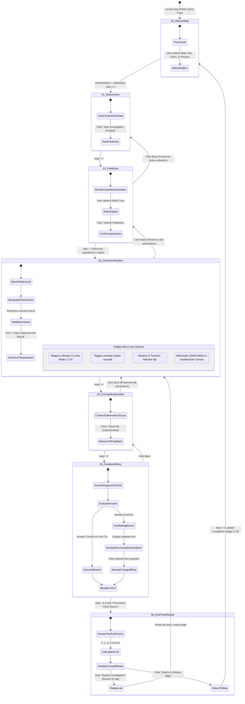

# SHARED LEARNING FLOW & SCREEN CONTRACT SPECIFICATION

**Document ID:** FLOW-SPEC-SHARED-JOURNEY-V2  
**Project:** Gramin PocketLab — Four-Subject STEM Missions  
**Event:** STEM for Impact 2026, Presidency University, Bengaluru  
**Role:** Product & Learning-Flow Specialist  
**Design Standard:** Strict adherence to approved four-subject charter. Shared 7-step pedagogical lifecycle without diluting subject-specific interaction models. **Zero application code authored; zero unrun claims.**  

---

## 1. End-to-End Shared Learning Flow Diagram (Mermaid)

The Mermaid state diagram below defines the deterministic navigation, branching, and state persistence rules across all four STEM subjects:

---

## 2. Rigorous Screen-by-Screen Contracts (S0 through S6)

### S0: Mission Map & Subject Selector
* **Purpose:** Introduce the product vision in one sentence; allow the learner to select any of the four active subject missions (multi-child profile switcher UI deferred from MVP; scoped to single anonymous learner session).
* **Exact User-Facing Content:**
  * Title: `"Gramin PocketLab"`
  * Subtitle: *"Explore real-world science and mathematics through four interactive field investigations designed for rural schools."*
  * Session Context: Single active local session (multi-student profile switcher UI deferred from MVP).
  * Four Subject Cards:
    1. *Mathematics:* `"Water Share Challenge"` | Subtitle: *"Divide community irrigation water proportionally using ratios."*
    2. *Biology:* `"Food Web Explorer"` | Subtitle: *"Discover how energy flows and what happens when predators vanish."*
    3. *Chemistry:* `"pH Color Lab"` | Subtitle: *"Test acids, neutrals, and bases using natural indicators."*
    4. *Physics:* `"Sound Detective"` | Subtitle: *"See and hear frequency, pitch, and loudness."*
* **Inputs & Available Actions:** Tap on any of the four subject cards; tap language toggle (`[ EN | KN* ]`).
* **State Read & Updated:** Reads `completedMissions` from `localStorage` under `pocketlab_progress`. Updates `activeSubject` on card click.
* **Validation Behavior:** All 4 routes are active; zero blank routes or "coming soon" placeholders.
* **Navigation & Reset Behavior:** Clicking a card transitions to S1 at `step = 1`.
* **Errors & Fallback:** If `localStorage` throws, falls back to in-memory session state.
* **Accessibility:** Full keyboard traversal (`Tab` / `Enter`); cards use `<article role="region" aria-label="Mathematics Mission">`.
* **Observable Acceptance Criteria:** Clicking any card switches the theme accent color to that subject and mounts S1 without unhandled console errors.

---

### S1: Mission Introduction
* **Purpose:** Ground the topic in a familiar rural scenario, state one measurable learning objective, and define estimated time.
* **Exact User-Facing Content:**
  * Subject Badge: `[ Subject Name ] (NCERT Class X)`
  * Scenario Narrative: 2–3 sentences grounding the problem (e.g. sharing village irrigation water, owl-grain field ecology, well-water turmeric testing, bamboo flute acoustics).
  * Objective Box: One clear measurable goal (e.g. *"Learn how to divide 12 units of water in a 1 : 2 : 3 ratio without wasting any water"*).
  * Metadata Bar: `Duration: ~5–7 mins` | `Curriculum: NCERT` | `Offline Ready`.
* **Inputs & Available Actions:** Primary action button: `[ Start Investigation (Predict) → ]`.
* **Microphone Permission Check:** **STRICTLY ZERO PERMISSION PROMPTS.** No audio or microphone requests are permitted on this screen.
* **State Read & Updated:** Reads `activeSubject`. Updates `currentStep = 2` on click.
* **Navigation & Reset:** Back button navigates to S0 (Mission Map).
* **Accessibility:** Clear heading structure (`<h1>` for App, `<h2>` for Mission Title, `<h3>` for Objective). Focus is automatically placed on `<h2>`.
* **Observable Acceptance Criteria:** Clicking primary action advances cleanly to S2.

---

### S2: Formative Prediction Question
* **Purpose:** Activate prior intuition and build active retrieval anticipation through a low-stakes hypothesis question before entering the lab.
* **Exact User-Facing Content:**
  * Header Callout: `"Make Your Prediction (No penalty for incorrect guesses!)"`
  * Scenario Question Prompt (e.g. *"If the total water is 12 units and the ratio is 1:2:3, how much water should Plot C get?"*).
  * Options: 3 accessible radio cards (e.g. `3 units`, `4 units`, `6 units`).
  * Optional Anxiety-Reduction Option: `"Not sure yet"` where pedagogically appropriate.
* **Inputs & Available Actions:** Tap on a radio card; click `[ Enter Lab → ]`.
* **State Read & Updated:** Reads `activeSubject`. Upon radio selection, enables the advance button. Updates `session.predictionChoiceId = selectedOptionId`.
* **Validation Behavior:** Advance button is disabled (`aria-disabled="true"`) until an option is selected.
* **Navigation & Reset:** Clicking `[ ← Back ]` returns to S1 without clearing the selected option.
* **Errors & Fallback:** If learner reloads the browser, `session.predictionChoiceId` is restored from `localStorage`.
* **Accessibility:** Radio cards grouped inside `<fieldset role="radiogroup" aria-labelledby="pred-legend">`.
* **Observable Acceptance Criteria:** Radio selection visually highlights with subject accent; advance button becomes clickable; choice is stored.

---

### S3: Interactive Exploration (The Micro-Lab)
* **Purpose:** Provide hands-on interactive manipulation of mathematical or physical variables with dynamic visual feedback.
* **Exact User-Facing Content by Subject:**
  * **Math:** 3 labeled plot containers (A, B, C) and 1 Master Tank. Status text: `"Allocated: [X] / 12 units"`. Invariant warning if sum $\ne 12$. Action: `[ Check Distribution ]`.
  * **Biology:** Directed SVG graph (Paddy $\rightarrow$ Grasshoppers/Mice $\rightarrow$ Frogs/Snakes $\rightarrow$ Owls). Legend: `"Arrows indicate direction of energy flow"`. Toggles: `[ Remove Snakes ]`, `[ Drought Mode ]`, `[ Restore Balance ]`. Collapsible text list for screen readers. Cautious qualitative observation panel.
  * **Chemistry:** 4 beakers (Lemon Juice [pH 2.2], Distilled Water [pH 7.0 reference], Baking Soda Solution [pH 8.5], Soap Solution [pH 10.0]). Indicator test selector: Natural Turmeric Paper (turns red-brown in alkaline base) and Universal Indicator paper (full 0–14 color scale). Status badges: `[ Acidic pH 2.2 ]`, `[ Neutral pH 7.0 ]`, `[ Basic pH 8.5 / 10.0 ]`. Permanent visible banner: *"Notice: Educational simulation. A neutral pH of 7 only measures hydrogen ion activity and does NOT prove water is biologically sterile or free from toxic dissolved chemicals."*
  * **Physics (Flagship):** Labeled 60 FPS educational oscilloscope canvas ($X = \text{Illustrative Time 0–10 ms}$, $Y = \text{Amplitude -1.0 to +1.0}$; displaying $2.2$ cycles at 220 Hz and $4.4$ cycles at 440 Hz). Presets: `[ Play 220 Hz (Low) ]`, `[ Play 440 Hz (High) ]`. Sliders: Frequency ($100–800\text{ Hz}$), Amplitude ($10–100\%$). Controls: `[ 🔊 Play Tone ]`, `[ ⏹ Stop Tone ]`. Optional: `[ 🎙 Test Microphone ]`.
* **Inputs & Available Actions:**
  * Math: $[-]$ and $[+]$ steppers ($48 \times 48\text{ px}$).
  * Bio: Scenario buttons.
  * Chem: Beaker and indicator selector buttons.
  * Phys: Sliders, playback toggles, preset buttons, mic toggle.
  * Shared: `[ ↺ Reset Lab ]` button to return parameters to default.
* **Audio & Microphone Security Contracts (Physics):**
  * Tones **never play automatically**; `AudioContext` remains suspended until user clicks `[ Play Tone ]`.
  * If user clicks `[ 🎙 Test Microphone ]`: Browser requests permission. If granted, streams live time-domain data to canvas. If denied, displays friendly toast: *"Microphone optional. Built-in tone generator active."* Lesson remains 100% playable. Zero audio is recorded or stored.
* **State Read & Updated:** Reads `activeSubject`. Updates subject interaction state in memory and `localStorage`.
* **Validation Behavior:**
  * Math: Primary button `[ I Have Observed the Result → ]` remains disabled until user achieves a valid distribution ($2, 4, 6$).
  * Bio, Chem, Phys: Primary button enables once learner triggers at least one meaningful interaction state.
* **Navigation & Reset:** `[ ↺ Reset Lab ]` restores variables to pristine baseline without resetting earned badges. `[ ← Back ]` returns to S2 preserving learner's prediction.
* **Accessibility:** All visual graphics paired with explicit text status badges; touch targets $\ge 48 \times 48\text{ px}$; reduced motion pauses continuous canvas loops.
* **Observable Acceptance Criteria:** Touching controls visibly alters the canvas/SVG output; units are clearly labeled; invariants are strictly enforced.

---

### S4: Concept Understanding
* **Purpose:** Synthesize the scientific or mathematical principle directly connected to what the learner observed in S3.
* **Exact User-Facing Content:**
  * Observation Recap Box: `"In the lab, you observed that..."` (Connects to actual interaction).
  * Core Concept Explanation: 2 bite-sized paragraphs explaining the governing scientific laws (e.g. ratio parts $1+2+3=6$; trophic cascades; hydrogen ion concentration; frequency vs. amplitude).
  * Field Notebook Rule Box: Highlighted box stating the generalizable rule.
* **Inputs & Available Actions:** Primary action button: `[ Check My Understanding → ]`.
* **State Read & Updated:** Reads `activeSubject`. Updates `currentStep = 5`.
* **Navigation & Reset:** Back button returns to S3 with all lab parameters intact.
* **Accessibility:** Semantic typography; reading width clamped to $680\text{ px}$ for comfortable readability.
* **Observable Acceptance Criteria:** Text directly references the experiment variables; advance button transitions cleanly to S5.

---

### S5: Formative Feedback & Targeted Retry
* **Purpose:** Diagnose whether the student holds naive domain misconceptions and provide immediate scaffolding with an altered retry question.
* **Exact User-Facing Content:**
  * Formative Diagnostic Question: Targets known cognitive misconceptions (e.g. *Additive Equipartition* in math; *Direct-Only* in bio; *Neutral Purity* in chem; *Loudness=Pitch* in physics).
  * Scaffolding Feedback Panel (if wrong): Explains *why* the answer failed based on observable evidence.
  * Changed Retry Question: Presents an isomorphic problem with different numbers or scenario (e.g. dividing 18 units in ratio $1:2$).
  * Success Feedback Panel: Reinforces why the correct answer is scientifically valid.
* **Inputs & Available Actions:** Select option radio; click `[ Submit Answer ]`; click `[ Try Changed Question ]`; click `[ Proceed to Final Check → ]`.
* **State Read & Updated:** Updates `progress[subject].formativePassedFirstTry` (boolean) and `retryAttempts` count.
* **Validation Behavior:** Evaluates answer deterministically against `ANSWER_KEY_AND_FEEDBACK.csv`. Avoids bare "Wrong" or empty praise.
* **Navigation & Reset:** Back button returns to S4.
* **Accessibility:** Live feedback rendered inside `
`.
* **Observable Acceptance Criteria:** Choosing an incorrect option reveals the targeted misconception feedback script; retry option successfully changes the question.

---

### S6: Exit Check & Mission Summary
* **Purpose:** Summative transfer assessment, true score calculation, and celebration of local mastery.
* **Exact User-Facing Content:**
  * Two Exit Check Questions: Practical transfer problems (e.g. mixing craft clay slurry in ratio 1:5; forest food web producer identification; bacterial water disclaimer verification; bat screech vs. lion roar amplitude).
  * Score Banner: `"Mission Complete: [ Subject Title ]"`. Displays: `"Exit Score: [ X / 2 Correct ]"`.
  * Concept Recap: 2 bullet points summarizing core principles.
  * Disclaimers: Makes **no exaggerated claims** of long-term learning gains from a single session.
* **Inputs & Available Actions:** Radio selections for both questions; click `[ Submit Final Check ]`; click `[ ↺ Replay Investigation ]`; click `[ Return to Mission Map → ]`.
* **State Read & Updated:** Calculates `exitScores: [score1, score2]`; sets `progress[subject].isCompleted = true`. Writes to `localStorage`.
* **Validation Behavior:** Score strictly matches actual user selections; answer keys reveal full explanations upon submission.
* **Navigation & Reset:** Clicking `[ Return to Mission Map ]` navigates to S0, where the completed subject card now displays its earned local mastery badge.
* **Accessibility:** Results summarized cleanly in an accessible definition list (`<dl>`).
* **Observable Acceptance Criteria:** Score updates accurately; returning to S0 reflects earned badge; completed session is stored deterministically.

---

## 3. Decisions Requiring Human Approval Before Kickoff

The team must confirm these final three human operational approvals:
1. **Pitch Alignment with Organizers:** Clarification with event organizers at check-in whether presenting Physics (Sound Detective) as our core flagship entry while demonstrating Math, Biology, and Chemistry satisfies the event's "pick one core STEM subject" wording (treated as an organizer inquiry to clarify rather than an established disqualifying rule).
2. **Kannada Translation Review:** Human review of the draft Kannada strings in `content/i18n.json` by a native-speaking educator.
3. **Pre-Event Code Freeze:** Confirmation that no application code will be authored until the official event timer starts.
